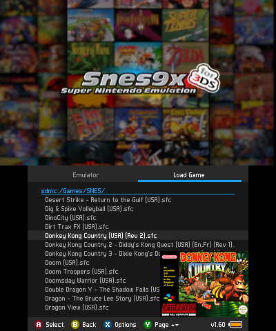
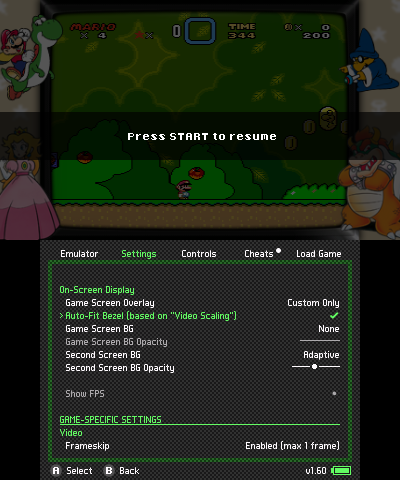
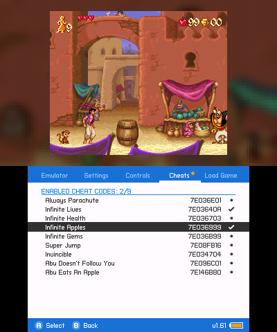
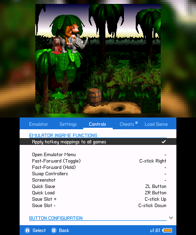
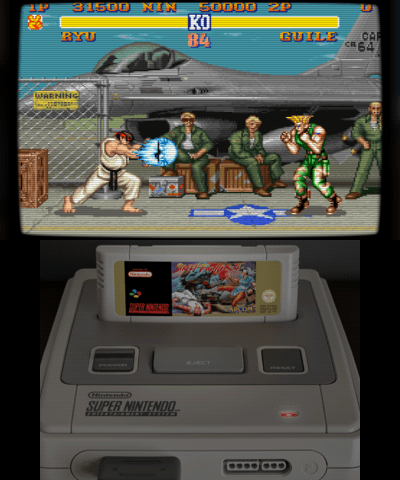
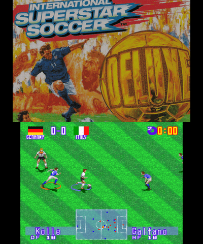
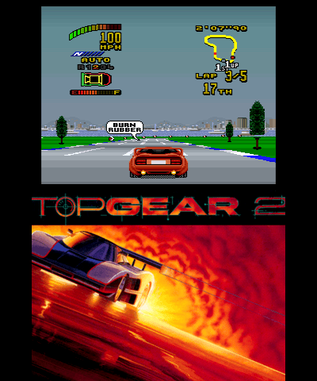
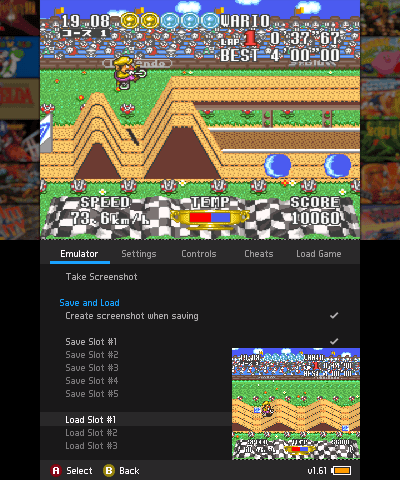

# Snes9x for 3DS

## Overview

This project is a fork of the legacy snes9x_3ds codebase by [bubble2k](https://github.com/bubble2k16/snes9x_3ds) and continues that work with a modernized architecture and improved user experience.
It builds with current devkitARM and libctru releases (as of Nov 2026). Optional assets are available in the dedicated asset repository: [snes9x_3ds-assets](https://github.com/matbo87/snes9x_3ds-assets).

It works on all 2DS and 3DS models.
Old 2DS/3DS run most SNES titles well. Demanding games, especially Super FX and SA-1 titles, can struggle; see [Old 3DS performance](KNOWN_ISSUES.md#old-3ds-performance).

Feedback and bug reports are welcome.

## Main features

* [RetroAchievements](#retroachievements)
* [Online Updater](#online-updater)
* Enhanced Resolution, including 800px wide mode (all models except Old 2DS)
* Improved rendering for HDMA-heavy games and mosaic effects
* SNES refresh rate matching (60.1 Hz for NTSC, 50 Hz for PAL)
* NDSP audio output
* Rich visual customization with thumbnails, themes, per-game backgrounds and overlays
* Crop and overscan
* Improved cheat management
* Extended hotkey options and screen swap support
* Directory caching for faster ROM list loading

## Setup

* A modded 3DS is required; DSP firmware (`/3ds/dspfirm.cdc`) is needed for sound output.
* Install via [Universal Updater](https://universal-team.net/projects/universal-updater.html) or with the latest `.cia` from [Releases](https://github.com/matbo87/snes9x_3ds/releases).
* Later updates can also be installed from the [Online Updater](#online-updater) on the Emulator tab.
* Download thumbnails, backgrounds and cheats with the Online Updater (Emulator tab) or install asset packs manually from [snes9x_3ds-assets releases](https://github.com/matbo87/snes9x_3ds-assets/releases).

ROMs can be stored in any folder. ZIP files are not supported.

Supported ROM formats:
* `.smc`
* `.sfc`
* `.fig`
* `.bs`
* `.bsx`

Configs, saves and imported assets are stored in `/3ds/snes9x_3ds`.

### 3DSX version

* Copy `snes9x_3ds.3dsx` to `/3ds/snes9x_3ds` on the SD card
* Start it from the Homebrew Launcher

## Assets (images and cheats)

Assets are provided in the dedicated asset repository: [snes9x_3ds-assets](https://github.com/matbo87/snes9x_3ds-assets).
Download them with the [Online Updater](#online-updater), or see the repository's README for manual installation and custom images.

Notes:

* The repository follows a 1G1R-style selection.
* Naming is strict No-Intro style for matching.

## Online Updater

Open it on the Emulator tab.

* Current Game: download game screen and second screen backgrounds and cheats for the loaded game.
* Appearance: download game thumbnails (gameplay, title or cover).
* Emulator Update: update to the latest release.

Enable `Check on launch` to check for emulator updates at startup (disabled by default).

## RetroAchievements

Unlock achievements from [RetroAchievements](https://retroachievements.org) as you play. A free account is required.

* Log in on the Emulator tab under RetroAchievements.
* Achievements are enabled for every game by default and can be turned off per game.
* Optional on-screen indicators show active challenges and progress.
* Encore mode reactivates unlocked achievements.
* Achievement progress is stored in savestates.

Limitations:

* **Softcore only.** Hardcore mode and leaderboards require meeting the [hardcore compliance requirements](https://docs.retroachievements.org/general/hardcore-compliance-requirements.html), which snes9x_3ds currently doesn't.
* Subsets are not supported.
* On Old 2DS/3DS, complex achievement sets can lower performance; achievements can be turned off per game.

## Building from source

* Install devkitPro and 3DS toolchain packages (including devkitARM, libctru, `3ds-curl` and `3ds-mbedtls`). If needed, follow the [devkitPro pacman guide](https://devkitpro.org/wiki/devkitPro_pacman).
* The Makefile clones citro3d v1.7.1, applies `patches/citro3d.patch` and builds it into `libs/citro3d`; a stock citro3d does not link.
* The Makefile is based on TricksterGuy's [3ds-template](https://github.com/TricksterGuy/3ds-template).

Clone with submodules to include rcheevos (RetroAchievements library):

```sh
git clone --recurse-submodules https://github.com/matbo87/snes9x_3ds.git
cd snes9x_3ds
```

For an existing checkout, run `git submodule update --init --recursive` before building.

Required command-line tools in `PATH`:

* For `3dsx` builds: `tex3ds`, `smdhtool`, `3dsxtool` (from the devkitPro 3DS toolchain).

Common build targets:

* `make 3dsx`
* `make citra`
* `make 3dslink` (sends the `.3dsx` to the Homebrew Launcher)

`make cia` uses the bundled `makerom` binary for the detected platform under `makerom/`.
Bundled binary provenance is documented in `makerom/BINARY_SOURCES.md`.

### Emulator status

* Citra (nightly ≤ 2104): working
* Azahar: Mode7 1024x1024 texture renders as a solid yellow texture

## Development and Contributions

New work usually lands on `develop` first. Merges to `master` create build artifacts via GitHub Actions. Tagged GitHub [releases](https://github.com/matbo87/snes9x_3ds/releases) are the official stable releases.

Community PRs are welcome. For larger changes, a short issue first is appreciated.
Please keep PRs focused and test on hardware where possible.
AI-assisted code is fine, but contributors are responsible for understanding and validating the code they submit.
Broad, risky, hard-to-review PRs may be closed or split into smaller changes. Prototype work may still be credited if it informs a later implementation.

AI note: I use AI assistants as part of my development workflow, including code review, debugging, planning, implementation and documentation. All changes are reviewed and adjusted by me before they are merged.

## Screenshots

<table>
  <tr>
    <td width="50%" align="center"></td>
    <td width="50%" align="center"></td>
  </tr>
  <tr>
    <td valign="top" width="50%" align="center">Start screen, "Game Thumbnail" option enabled</td>
    <td valign="top" width="50%" align="center">Pause screen, per-game overlay enabled</td>
  </tr>
  <tr><td colspan="2"></td></tr>
  <tr></tr>
  <tr>
    <td width="50%" align="center"></td>
    <td width="50%" align="center"></td>
  </tr>
  <tr>
    <td valign="top" width="50%" align="center">Cropped top & bottom, cheats enabled</td>
    <td valign="top" width="50%" align="center">Applied hotkeys</td>
  </tr>
  <tr><td colspan="2"></td></tr>
  <tr></tr>
  <tr>
    <td width="50%" align="center"></td>
    <td width="50%" align="center"></td>
  </tr>
  <tr>
    <td valign="top" width="50%" align="center">Crop & overscan, scanlines enabled</td>
    <td valign="top" width="50%" align="center">Swapped screen</td>
 </tr>
 <tr>
    <td width="50%" align="center"></td>
    <td width="50%" align="center"></td>
  </tr>
  <tr>
    <td valign="top" width="50%" align="center">In-Frame Palette Changes enabled</td>
    <td valign="top" width="50%" align="center">BS-X game, savestate preview</td>
 </tr>
 </table>
 <br>

## Frequently Asked Questions

### A game runs slow. How can I improve performance?

* Increase `Frameskip` (more than 2 frames isn't recommended)
* With `In-Frame Palette Changes` set to `Enabled`, check layers under `Advanced Settings` > `Reduce Layer Draws on Palette Changes`. This can increase FPS in games like Top Gear. A layer that needs mid-frame palette updates will glitch, so test each layer per game.
* Set `In-Frame Palette Changes` to `Disabled (start palette)` or `Disabled (end palette)`
* Set `Enhanced Resolution` to `Off`
* Turn off RetroAchievements for the game
* Disable 3D and/or on-screen display settings

### A game looks or sounds wrong. What can I try?

* Set `In-Frame Palette Changes` to `Enabled`
* Increase `Audio Buffer` if audio crackles, skips or stutters
* Enabled cheats can break visuals or gameplay; disable cheats and reload the game
* Check that the ROM is valid (No-Intro is highly recommended; ROM hacks often have issues)
* Check the [known issues](KNOWN_ISSUES.md)

### Cheats are not working properly

* Cheat support is only lightly tested and some codes may not work correctly
* Use cheats with caution: broken codes can affect gameplay or damage save data

### Satellaview (BS-X) games

Satellaview games are supported, but compatibility is hit-or-miss.
See [Known Issues](KNOWN_ISSUES.md#satellaview-bs-x-games) for details and per-game status.

## License

Some files may carry their own license headers, but because this project includes the Snes9x core (`source/Snes9x/`), redistribution of the combined project follows the Snes9x non-commercial license terms.

See:
* [LICENSE.md](LICENSE.md)
* [THIRD_PARTY_NOTICES.md](THIRD_PARTY_NOTICES.md)

## Credits

* The Snes9x team for the SNES emulator core, and the libretro Snes9x core maintainers for ongoing reference work
* bubble2k, original author of [snes9x_3ds](https://github.com/bubble2k16/snes9x_3ds), for creating the excellent base this fork builds on
* Wyatt-James for the SuperFX optimizations and fixes ([#85](https://github.com/matbo87/snes9x_3ds/pull/85)), and for the safety, audio and stability fixes adapted from the [snes9x_3ds fork](https://github.com/Wyatt-James/snes9x_3ds)
* ramzinouri's [snes9x_3ds fork](https://github.com/ramzinouri/snes9x_3ds) inspired the image border/background and theme support
* willjow's [snes9x_3ds fork](https://github.com/willjow/snes9x_3ds) revived the project after development had gone quiet
* [RetroAchievements](https://retroachievements.org) for the achievement service, the rcheevos library and the community-made achievement sets
* The Citra/Azahar teams for making 3DS emulator testing and debugging practical
* Everyone reporting issues, testing games and suggesting improvements
